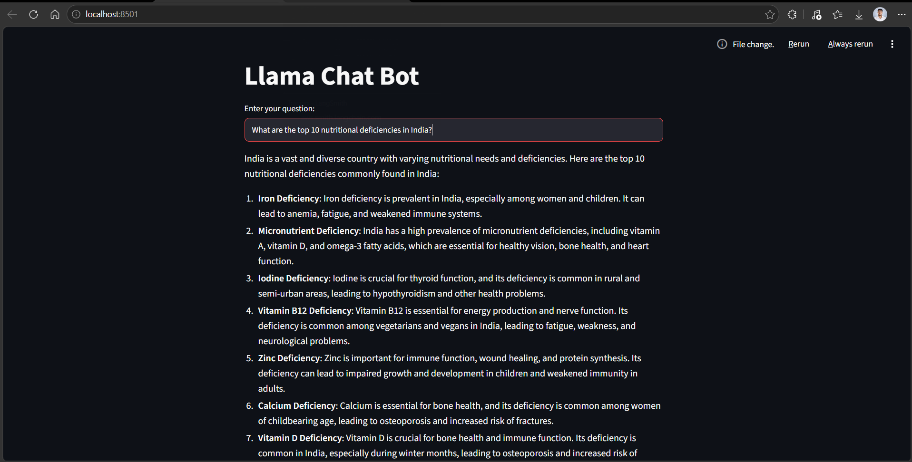
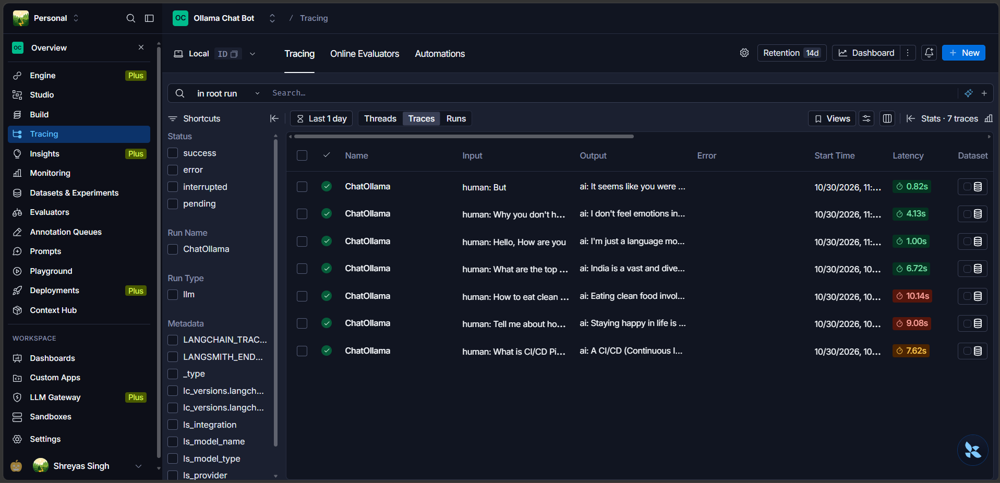

# Llama Chatbot with LangSmith Tracking

A simple AI chatbot built using Streamlit, LangChain, and Ollama. It uses the locally running Llama 3.2 model to generate responses to user questions.

## Technologies Used
- Python
- Streamlit
- LangChain
- Ollama (Llama 3.2)
- LangSmith
- Python-dotenv

## Features
- Interactive chatbot interface using Streamlit.
- Runs locally using Ollama.
- Generates responses using Llama 3.2.
- LangSmith integration for application tracing and monitoring.

## Application Screenshot



## LangSmith Tracking



## Installation

**1. Clone the repository**

```bash
git clone <your-repository-url>
cd <repository-name>
```

**2. Install dependencies**

```bash
pip install streamlit langchain-ollama python-dotenv
```

**3. Install and download the Ollama model**

```bash
ollama pull llama3.2
```

**4. Configure LangSmith**

Add your LangSmith credentials and tracing configuration to the `.env` file:

```env
LANGCHAIN_API_KEY = your_langsmith_api_key
LANGSMITH_AGENT_ID= ollama-chat-bot
LANGCHAIN_TRACING = true
LANGSMITH_ENDPOINT= https://aws.api.smith.langchain.com
LANGSMITH_AGENT_ENVIRONMENT= local
(Change values according to your config)
```

**5. Run the application**

```bash
streamlit run app.py
```

## How It Works

1. User enters a question in the Streamlit interface.
2. LangChain sends the prompt to the Ollama Llama 3.2 model.
3. The model generates a response locally.
4. The response is displayed in the Streamlit application.
5. LangSmith can track application execution when tracing is configured.

## Project Structure

```text
Llama-Chatbot/
│
├── app.py
├── .env
├── chatbot.png
├── langsmith_tracking.png
├── requirements.txt
└── README.md
```

## Key Learnings
- Integrating Ollama with LangChain.
- Building interactive AI applications using Streamlit.
- Running LLMs locally.
- Tracking and monitoring LLM applications using LangSmith.