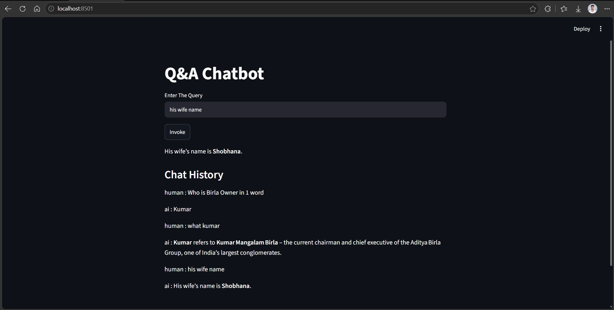

# GenAI Assignment A27: Chatbots with Conversation History using LangChain

## Overview
This assignment focuses on implementing conversation history in LangChain, managing chat messages, trimming old messages, and building a stateful Q&A chatbot using Streamlit.

## Tasks Completed

### Task 1: Understanding Chat Messages
- Explored SystemMessage, HumanMessage, and AIMessage.
- Understood message-based prompting.

### Task 2: MessagePlaceholder Usage
- Created ChatPromptTemplate.
- Used MessagesPlaceholder for chat history.
- Injected dynamic conversation history into prompts.

### Task 3: Basic Message History
- Stored conversation messages in a list.
- Appended HumanMessage and AIMessage after interactions.
- Passed conversation history to the LLM.

### Task 4: Trimming Chat History
- Implemented trim_messages.
- Used token-based history management.
- Explored max_tokens, token_counter, include_system, allow_partial, and start_on.

### Task 5 & 6: Stateful Q&A Chatbot
- Built a chatbot using RunnableWithMessageHistory.
- Used ChatMessageHistory to store conversations.
- Maintained conversation history using session IDs.
- Integrated Streamlit for the chatbot interface.
- Used st.session_state to preserve history across Streamlit reruns.
- Tested follow-up questions using previous conversation context.

## Tech Stack
- Python
- LangChain
- Groq (LLM)
- Streamlit
- ChatMessageHistory
- RunnableWithMessageHistory
- python-dotenv

## Chatbot Screenshot

## Learning Outcomes
- Understanding conversation history in LangChain.
- Working with message placeholders.
- Managing and trimming chat history.
- Building stateful chatbots.
- Integrating LangChain with Streamlit.
