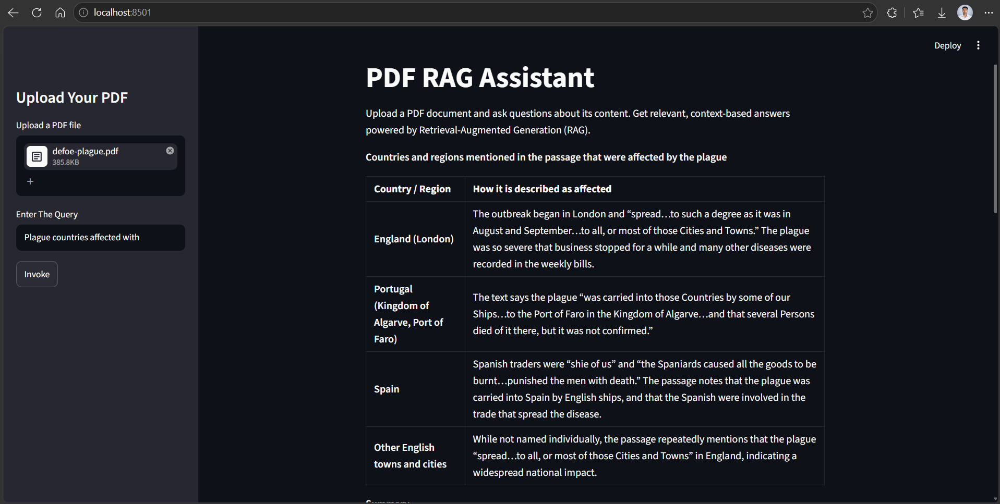
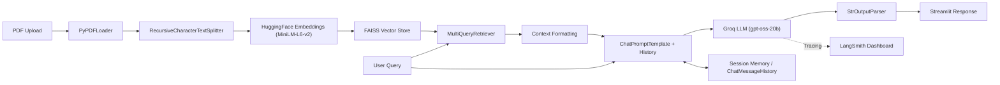

# 📄 GenAI Assignment 30: PDF RAG Assistant with Conversational Memory

An interactive **Retrieval-Augmented Generation (RAG)** web application built with **Streamlit**, **LangChain**, **FAISS**, and **Groq**. Upload any PDF document and ask natural-language questions — the assistant retrieves relevant context from the document and generates accurate, grounded answers with full multi-turn conversational memory.

---

## 📸 Screenshot

### Streamlit Web App Interface


---

## 🌟 Key Features

- **PDF Upload & Parsing**: Upload any PDF file via the sidebar; the document is parsed page-by-page using `PyPDFLoader`.
- **Intelligent Chunking**: Documents are split into overlapping chunks (1000 chars, 50 overlap) using `RecursiveCharacterTextSplitter` for optimal retrieval.
- **Semantic Embeddings**: Text chunks are embedded using HuggingFace's `sentence-transformers/all-MiniLM-L6-v2` model for high-quality vector representations.
- **FAISS Vector Store**: Chunks are indexed in a FAISS vector store for fast similarity-based retrieval.
- **Multi-Query Retrieval**: Uses LangChain's `MultiQueryRetriever` to generate multiple query perspectives, improving recall over standard retrieval.
- **Conversational Memory**: Session-based chat history via `RunnableWithMessageHistory` and `ChatMessageHistory`, enabling follow-up questions and multi-turn conversations.
- **Cloud LLM Inference**: Powered by **Groq** (`openai/gpt-oss-20b`) for fast, high-quality response generation.
- **LangSmith Observability**: Integrated tracing and monitoring via **LangSmith** for debugging and performance analysis.

---

## 🏗️ Architecture & Workflow



---

## 📁 Project Structure

```text
GenAI-Assignment30-(Shreyas)/
├── app.py              # Main Streamlit application with RAG pipeline
├── app.ipynb           # Jupyter notebook for prototyping the RAG pipeline
├── defoe-plague.pdf    # Sample PDF document (Daniel Defoe's plague narrative)
├── main.png            # Screenshot of the web application
├── .env                # API keys and environment configuration (git-ignored)
├── requirements.txt    # Project dependencies
└── README.md           # Project documentation
```

---

## 📋 Prerequisites

Before running the project, ensure you have:

1. **Python 3.10+** installed.
2. A **Groq API Key** ([console.groq.com](https://console.groq.com/)).
3. *(Optional)* A **LangSmith API Key** ([smith.langchain.com](https://smith.langchain.com/)) for observability.

---

## ⚙️ Installation & Setup

### 1. Clone the Repository
```bash
git clone https://github.com/shreyas-650/Assignment-GenAI.git
cd "Assignment-GenAI/GenAI-Assignment30-(Shreyas)"
```

### 2. Create and Activate a Virtual Environment
```bash
# Windows
python -m venv venv
venv\Scripts\activate

# macOS / Linux
python3 -m venv venv
source venv/bin/activate
```

### 3. Install Dependencies
```bash
pip install -r requirements.txt
```

You may also need to install these additional packages:
```bash
pip install streamlit langchain-text-splitters langchain-huggingface langchain-classic faiss-cpu
```

### 4. Configure Environment Variables
Create a `.env` file in the project folder:

```env
# Groq API Key
GROQ_API_KEY=gsk_your_groq_api_key_here

# LangSmith Observability (optional)
LANGSMITH_API_KEY=lsv2_pt_your_langsmith_api_key_here
LANGSMITH_TRACING=true
LANGSMITH_ENDPOINT=https://api.smith.langchain.com
```

---

## 🚀 Running the Application

Start the Streamlit application:
```bash
streamlit run app.py
```

Open your browser at `http://localhost:8501`, then:

1. **Upload a PDF** via the sidebar.
2. **Enter a query** in the text input.
3. Click **Invoke** to get a context-grounded answer.
4. Ask follow-up questions — the assistant remembers the conversation!

---

## 🔧 How It Works

1. **Document Ingestion**: The uploaded PDF is saved to a temp file, loaded with `PyPDFLoader`, then the temp file is deleted.
2. **Chunking**: The document pages are split into 1000-character chunks with 50-character overlap using `RecursiveCharacterTextSplitter`.
3. **Embedding & Indexing**: Each chunk is embedded with `sentence-transformers/all-MiniLM-L6-v2` and stored in a FAISS index.
4. **Multi-Query Retrieval**: When a user asks a question, `MultiQueryRetriever` generates multiple reformulations of the query and retrieves relevant chunks for each.
5. **Augmented Generation**: The retrieved context is injected into a prompt template along with the conversation history, and sent to the Groq LLM.
6. **Response**: The LLM generates an answer strictly grounded in the retrieved context. If the context is insufficient, it responds with "I do not know."

---

## 🔍 Observability with LangSmith

With `LANGSMITH_TRACING=true`, every interaction is automatically logged to your LangSmith dashboard:
- **Trace Latency**: Monitor response times for the full RAG pipeline.
- **Prompt Inspection**: View exact prompts with formatted context and conversation history.
- **Run Metadata**: Debug outputs, token usage, and execution graphs in real-time.

---

## 📜 License

This project is part of the GenAI Assignment series by [shreyas-650](https://github.com/shreyas-650).
