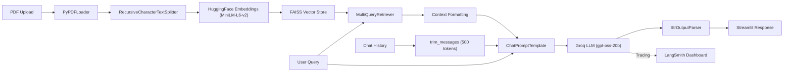

# 📄 GenAI Assignment 31: PDF RAG Assistant with Conversation Trimming

An interactive **Retrieval-Augmented Generation (RAG)** web application built with **Streamlit**, **LangChain**, **FAISS**, and **Groq**. This project extends the PDF RAG pipeline by adding **message history trimming** using LangChain's `trim_messages`, ensuring the conversation stays within token limits while preserving answer quality.

---

## 🌟 Key Features

- **PDF Upload & Parsing**: Upload any PDF via the sidebar; parsed page-by-page using `PyPDFLoader`.
- **Intelligent Chunking**: Documents split into overlapping chunks (1000 chars, 50 overlap) using `RecursiveCharacterTextSplitter`.
- **Semantic Embeddings**: Text embedded using HuggingFace's `sentence-transformers/all-MiniLM-L6-v2`.
- **FAISS Vector Store**: Fast similarity-based retrieval over document chunks.
- **Multi-Query Retrieval**: `MultiQueryRetriever` generates multiple query perspectives for improved recall.
- **Conversational Memory**: Session-based chat history via `RunnableWithMessageHistory` and `ChatMessageHistory`.
- **🆕 Message Trimming**: Uses `trim_messages` to cap conversation history at 500 tokens, keeping the context window efficient while retaining the system message and starting from human turns.
- **Cloud LLM Inference**: Powered by **Groq** (`openai/gpt-oss-20b`) for fast response generation.
- **LangSmith Observability**: Integrated tracing for debugging and performance monitoring.

---

## 🏗️ Architecture & Workflow



---

## 📁 Project Structure

```text
GenAI-Assignment31-(Shreyas)/
├── app.py              # Main Streamlit app with RAG pipeline + message trimming
├── app.ipynb           # Jupyter notebook for prototyping & observations
├── defoe-plague.pdf    # Sample PDF document (Daniel Defoe's plague narrative)
├── .env                # API keys and environment configuration (git-ignored)
├── requirements.txt    # Project dependencies
└── README.md           # Project documentation
```

---

## 📋 Prerequisites

Before running the project, ensure you have:

1. **Python 3.10+** installed.
2. A **Groq API Key** ([console.groq.com](https://console.groq.com/)).
3. *(Optional)* A **LangSmith API Key** ([smith.langchain.com](https://smith.langchain.com/)) for observability.

---

## ⚙️ Installation & Setup

### 1. Clone the Repository
```bash
git clone https://github.com/shreyas-650/Assignment-GenAI.git
cd "Assignment-GenAI/GenAI-Assignment31-(Shreyas)"
```

### 2. Create and Activate a Virtual Environment
```bash
# Windows
python -m venv venv
venv\Scripts\activate

# macOS / Linux
python3 -m venv venv
source venv/bin/activate
```

### 3. Install Dependencies
```bash
pip install -r requirements.txt
```

### 4. Configure Environment Variables
Create a `.env` file in the project folder:

```env
# Groq API Key
GROQ_API_KEY=gsk_your_groq_api_key_here

# LangSmith Observability (optional)
LANGSMITH_API_KEY=lsv2_pt_your_langsmith_api_key_here
LANGSMITH_TRACING=true
LANGSMITH_ENDPOINT=https://api.smith.langchain.com
```

---

## 🚀 Running the Application

```bash
streamlit run app.py
```

Open your browser at `http://localhost:8501`, then:

1. **Upload a PDF** via the sidebar.
2. **Enter a query** in the text input.
3. Click **Invoke** to get a context-grounded answer.
4. Ask follow-up questions — the assistant remembers the conversation (with trimmed history)!

---

## 🔧 How It Works

1. **Document Ingestion**: The uploaded PDF is saved to a temp file, loaded with `PyPDFLoader`, then the temp file is cleaned up.
2. **Chunking**: Pages are split into 1000-character chunks with 50-character overlap.
3. **Embedding & Indexing**: Chunks are embedded with `sentence-transformers/all-MiniLM-L6-v2` and stored in a FAISS index.
4. **Multi-Query Retrieval**: `MultiQueryRetriever` reformulates the user query into multiple perspectives and retrieves relevant chunks for each.
5. **History Trimming**: Before each invocation, `trim_messages` trims the conversation history to 500 tokens, keeping the system message and starting from human turns to maintain coherent context.
6. **Augmented Generation**: Retrieved context + trimmed history are injected into the prompt and sent to the Groq LLM.
7. **Response**: The LLM answers strictly from the retrieved context. If insufficient, it responds with "I do not know."
8. **Display**: Only trimmed messages are shown in the UI, reflecting the actual context the model sees.

---

## ✂️ Message Trimming Details

```python
trimmer = trim_messages(
    max_tokens=500,
    token_counter=LLM,
    include_system=True,
    start_on='human',
    allow_partial=False
)
```

| Parameter | Value | Purpose |
|---|---|---|
| `max_tokens` | 500 | Maximum tokens to keep in history |
| `token_counter` | LLM | Uses the Groq model to count tokens accurately |
| `include_system` | True | Always preserves the system message |
| `start_on` | `'human'` | Trimmed history always starts from a human message |
| `allow_partial` | False | Never cuts a message in half |

---

## 💡 Observations & Insights

1. **PDF Q&A vs Conversational PDF Q&A**: Conversational Q&A has memory, allowing it to use old message context for follow-up questions.
2. **Role of Message History**: Critical when past context is needed for the current query (e.g., "Tell me more about that").
3. **Long Memory vs Performance Trade-offs**: Long memory takes more time to process and consumes more tokens, increasing latency and cost.
4. **How Trimming Affects Quality**: Trimming ensures the context length stays within limits, preventing token overflow while preserving the most recent and relevant conversation turns.

---

## 📜 License

This project is part of the GenAI Assignment series by [shreyas-650](https://github.com/shreyas-650).
