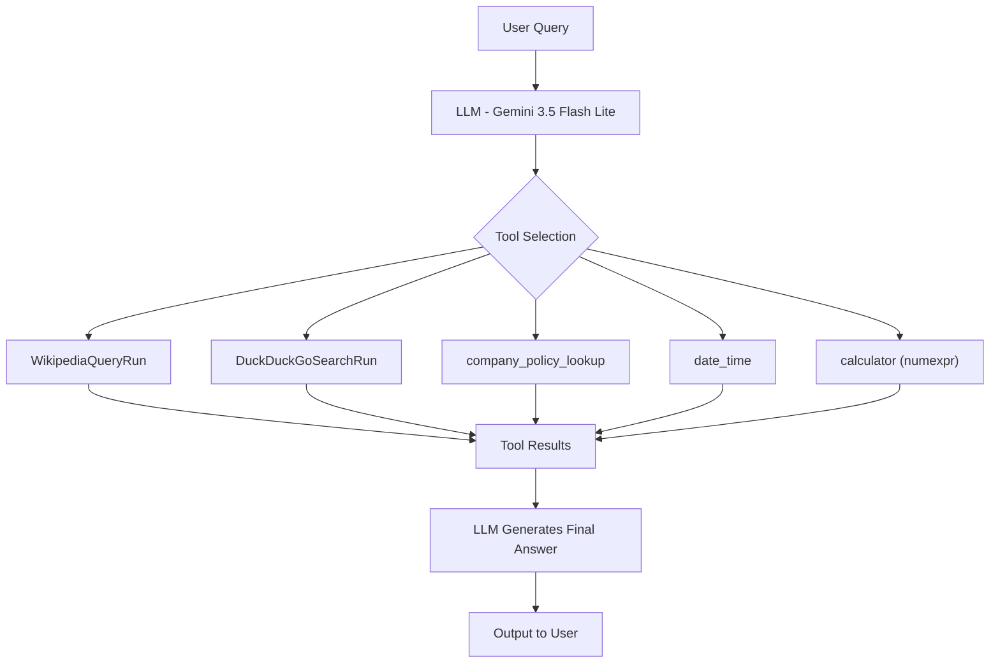

# 🛠️ GenAI Assignment 32: Tools in AI Agents

A comprehensive Jupyter Notebook exploring **Tools in AI Agents** using **LangChain** and **Google Gemini**. This assignment covers built-in tools, custom tools & toolkits, tool binding & calling, ReAct agents, and building a multi-tool agent.

---

## 🌟 Key Topics Covered

### Part 1 — Tools in AI Agents (Theory)
- What is a tool in an AI Agent?
- Why do agents need tools?
- Difference between a chatbot and an agent.

### Part 2 — Built-in Tools in LangChain (Task 2)
- **WikipediaQueryRun**: Query Wikipedia for real-time information.
- **DuckDuckGoSearchRun**: Perform web searches using DuckDuckGo.

### Part 3 — Creating Custom Tools & Toolkits (Tasks 3–4)
- Define custom tools using the `@tool` decorator (`company_policy_lookup`, `date_time`).
- Bundle tools into a custom **Toolkit** class with `get_tools()`.

### Part 4 — Tool Binding & Tool Calling (Tasks 5–6)
- Bind tools to a Gemini LLM using `bind_tools()`.
- Execute single-tool and **multi-tool** calling flows with message history.
- Process `ToolMessage` results and generate final answers.

### Part 5 — ReAct Agent (Tasks 7–8)
- Overview of **ReAct (Reason + Act)** methodology: Think → Act → Observe → Answer.
- Build a ReAct agent using `create_react_agent` and `AgentExecutor` from `langchain-classic`.

### Part 6 — Multi-Tool Agent (Task 9)
- Build an agent with `create_agent` from `langchain` combining:
  - **Calculator** (using `numexpr`)
  - **Date/Time** tool
  - **DuckDuckGo Search** tool

### Part 7 — Observations & Insights (Task 11)
- Benefits and challenges of tool-augmented agents.
- Chains vs Agents comparison.
- When to use Agents over RAG.

---

## 🏗️ Architecture & Workflow



---

## 📁 Project Structure

```text
GenAI-Assignment32-(Shreyas)/
├── app.ipynb           # Main Jupyter Notebook with all tasks and outputs
├── .env                # API keys and environment configuration (git-ignored)
├── requirements.txt    # Project dependencies
└── README.md           # Project documentation
```

---

## 📋 Prerequisites

Before running the project, ensure you have:

1. **Python 3.12+** installed.
2. A **Google Gemini API Key** ([aistudio.google.com](https://aistudio.google.com/)).
3. *(Optional)* A **LangSmith API Key** ([smith.langchain.com](https://smith.langchain.com/)) for observability.

---

## ⚙️ Installation & Setup

### 1. Clone the Repository
```bash
git clone https://github.com/shreyas-650/Assignment-GenAI.git
cd "Assignment-GenAI/GenAI-Assignment32-(Shreyas)"
```

### 2. Create and Activate a Virtual Environment
```bash
# Windows
python -m venv venv
venv\Scripts\activate

# macOS / Linux
python3 -m venv venv
source venv/bin/activate
```

### 3. Install Dependencies
```bash
pip install -r requirements.txt
```

### 4. Configure Environment Variables
Create a `.env` file in the project folder:

```env
# Google Gemini API Key
GOOGLE_API_KEY=your_google_api_key_here

# LangSmith Observability (optional)
LANGSMITH_API_KEY=lsv2_pt_your_langsmith_api_key_here
LANGSMITH_TRACING=true
LANGSMITH_ENDPOINT=https://api.smith.langchain.com
```

---

## 🚀 Running the Notebook

```bash
jupyter notebook app.ipynb
```

Run cells sequentially to execute each task. The notebook includes outputs from all tasks for reference.

---

## 🔧 How It Works

1. **Built-in Tools**: Wikipedia and DuckDuckGo tools are initialized from `langchain-community` and invoked directly.
2. **Custom Tools**: Python functions decorated with `@tool` become LangChain-compatible tools with auto-generated schemas.
3. **Toolkit**: A `CompanyToolkit` class bundles related tools and exposes them via `get_tools()`.
4. **Tool Binding**: Tools are bound to the Gemini LLM using `bind_tools()`, enabling the model to decide when to call them.
5. **Tool Calling**: The LLM returns `tool_calls` in its response; the code dispatches these to the correct tool, collects results as `ToolMessage`, and feeds them back for a final answer.
6. **ReAct Agent**: Uses a structured prompt with Thought/Action/Observation loops, managed by `AgentExecutor` with `max_iterations=5`.
7. **Multi-Tool Agent**: A higher-level `create_agent` API combines calculator, date/time, and search tools with a system prompt.

---

## 💡 Observations & Insights

| Aspect | Details |
|---|---|
| **Benefits** | Access external info, perform calculations, automate tasks, improve accuracy |
| **Challenges** | Tool execution errors, incorrect tool selection, higher latency/cost, security concerns |
| **Chains vs Agents** | Chains follow predefined steps; Agents decide dynamically |
| **Agents vs RAG** | Use agents for multi-step tasks, API calls, calculations; use RAG for document-based Q&A |

---

## 📜 License

This project is part of the GenAI Assignment series by [shreyas-650](https://github.com/shreyas-650).
