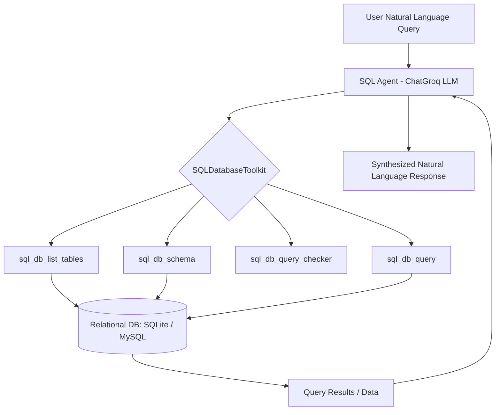

# 🗄️ GenAI Assignment 33: SQL Agents with LangChain & Groq

A comprehensive Jupyter Notebook exploring **SQL Agents and Database Querying** using **LangChain**, **SQLAlchemy**, and **Groq (ChatGroq)**. This assignment covers creating and querying relational databases (SQLite & MySQL), connecting them via LangChain's `SQLDatabase`, utilizing `SQLDatabaseToolkit`, and building intelligent `SQL Agent` workflows with tool-calling capabilities.

---

## 🌟 Key Topics Covered

### Part 1 — Storing Data in SQLite Database (Cells 0–3)
- Create SQLite database (`company.db`).
- Define schema and create tables:
  - `employees` (`id`, `name`, `department`, `salary`)
  - `sales` (`sale_id`, `employee_id`, `amount`, `sale_date`)
- Insert sample records and verify records using raw SQLite queries.

### Part 2 — Connecting LangChain to Relational Databases (Cells 4–5)
- **SQLite Connection**:
  - Connect SQLAlchemy engine to `sqlite:///company.db`.
  - Wrap engine with LangChain's `SQLDatabase`.
  - Inspect usable table names and extract schema information.
- **MySQL Connection**:
  - Build SQLAlchemy connection URL (`mysql+pymysql`).
  - Connect to a MySQL instance (`college_db`) and inspect schema information.

### Part 3 — SQL Database Toolkit (Cells 6–7)
- Initialize `SQLDatabaseToolkit` with `ChatGroq` (`openai/gpt-oss-20b`) and `SQLDatabase`.
- Inspect default toolkit tools:
  - `sql_db_query`: Execute SQL queries against database.
  - `sql_db_schema`: Retrieve schema and sample rows for given tables.
  - `sql_db_list_tables`: List available tables.
  - `sql_db_query_checker`: Validate SQL syntax before execution.
- Directly invoke individual tools (`sql_db_schema`, `sql_db_query`).

### Part 4 — Building SQL Agents (Cells 8–9)
- Build dynamic SQL agents using `create_sql_agent` with `agent_type="tool-calling"`.
- Query MySQL database using natural language (e.g., `"Show all students"`).
- Query SQLite `company.db` using multi-turn natural language questions:
  - *"How many employees are there in each department?"*
  - *"Who has the highest salary?"*
  - *"What is the total sales amount?"*
  - *"What is the average salary per department?"*

### Part 5 — Observations & Insights (Cell 10)
- Why SQL agents are superior to manual SQL generation for non-technical users.
- Differences between SQL Agents (live structured DB execution) and RAG (retrieval on unstructured chunked text).
- Security risks and precautions regarding unrestricted SQL database access.

---

## 🏗️ Architecture & Workflow



---

## 📁 Project Structure

```text
GenAI-Assignment33-(Shreyas)/
├── app.ipynb           # Main Jupyter Notebook containing all steps, code, and outputs
├── company.db          # SQLite database containing employees and sales tables
├── .env                # API keys and environment variables (git-ignored)
├── requirements.txt    # Project dependencies
└── README.md           # Project documentation
```

---

## 📋 Prerequisites

Before running the project, ensure you have:

1. **Python 3.10+** installed.
2. A **Groq API Key** ([console.groq.com](https://console.groq.com/)).
3. *(Optional)* A running **MySQL** server instance if testing MySQL connections.
4. *(Optional)* A **LangSmith API Key** ([smith.langchain.com](https://smith.langchain.com/)) for observability and tracing.

---

## ⚙️ Installation & Setup

### 1. Clone the Repository
```bash
git clone https://github.com/shreyas-650/Assignment-GenAI.git
cd "Assignment-GenAI/GenAI-Assignment33-(Shreyas)"
```

### 2. Create and Activate a Virtual Environment
```bash
# Windows
python -m venv venv
venv\Scripts\activate

# macOS / Linux
python3 -m venv venv
source venv/bin/activate
```

### 3. Install Dependencies
```bash
pip install -r requirements.txt
```

### 4. Configure Environment Variables
Create a `.env` file in the project directory:

```env
# Groq API Key
GROQ_API_KEY=your_groq_api_key_here

# LangSmith Tracing (Optional)
LANGSMITH_TRACING=true
LANGSMITH_API_KEY=your_langsmith_api_key_here
LANGSMITH_ENDPOINT=https://aws.api.smith.langchain.com
LANGSMITH_AGENT_ID=sql-agent
```

---

## 🚀 Running the Notebook

```bash
jupyter notebook app.ipynb
```

Execute cells sequentially to create the database, inspect tables, bind tools, and run the SQL agent queries.

---

## 💡 Key Takeaways & Observations

| Aspect | Summary |
|---|---|
| **SQL Agents vs Manual SQL** | Users don't need SQL syntax knowledge; agents dynamically inspect schemas, construct accurate queries, and format results into plain English. |
| **SQL Agent vs RAG** | SQL agents execute live analytical queries (aggregations, joins, filtering) on structured relational databases; RAG retrieves semantic chunks from unstructured text collections. |
| **Security Risks & Mitigations** | Direct write/drop permissions pose severe data deletion or injection risks. In production, use **read-only database credentials**, row/table permission boundaries, and query verification hooks. |

---

## 📜 License

This project is part of the GenAI Assignment series by [shreyas-650](https://github.com/shreyas-650).
