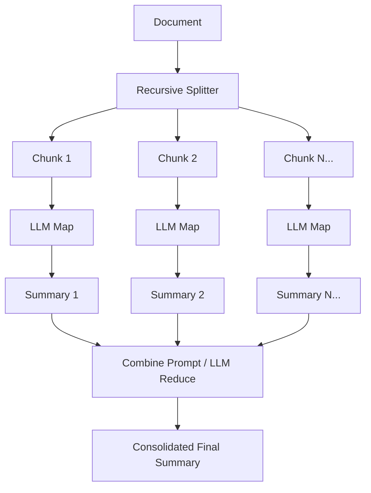
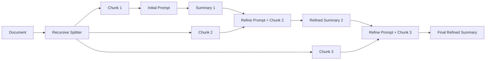

# 📄 GenAI Assignment 34: Document Summarization with LangChain

A comprehensive Jupyter Notebook exploring **Document Summarization Techniques** using **LangChain**, **Google Gemini**, and **Groq**. This assignment covers loading PDF documents, building basic summarization pipelines with LCEL and `PromptTemplate`, and mastering the three core LangChain summarization strategies: **Stuff**, **Map-Reduce**, and **Refine**, culminating in a reusable multi-strategy summarization function.

---

## 🌟 Key Topics Covered

### Part 1 — Document Loading & Basic Prompt Summarization (Cells 0–2)
- **PDF Document Loading**: Load and inspect multi-page PDF research papers (`paper.pdf`) using `PyPDFLoader` from `langchain_community.document_loaders`.
- **LCEL Summarization Pipeline**: Construct a basic summarization chain using `PromptTemplate` and `ChatGoogleGenerativeAI` (`gemini-3-flash-preview`).
- **Flexible Summary Styles**:
  - Word-budget constrained summaries (100 words).
  - Short narrative summaries (5–6 lines).
  - Structured bullet-point summaries.

### Part 2 — Stuff Summarization Chain (Cells 3–5)
- **Concept & Architecture**: Stuffing all document content or chunks directly into a single prompt for one-shot LLM evaluation.
- **Implementation**: Implement `load_summarize_chain` with `chain_type="stuff"`.
- **Comparison & Trade-offs**: Compare prompt-based LCEL chains vs. `load_summarize_chain` wrapper. Highlight context length limits and memory constraints when dealing with long documents.

### Part 3 — Map-Reduce Summarization Chain (Cells 6–8)
- **Concept & Architecture**: Overcoming token limits by splitting documents into chunks, independently summarizing each chunk (Map step), and aggregating chunk summaries into a final synthesis (Reduce step).
- **Document Chunking**: Split documents using `RecursiveCharacterTextSplitter` (`chunk_size=1000`, `chunk_overlap=0`).
- **Implementation**: Build a Map-Reduce summarization chain using `load_summarize_chain` with `chain_type="map_reduce"` powered by `ChatGroq` (`openai/gpt-oss-20b`).

### Part 4 — Refine Summarization Chain (Cells 9–10)
- **Concept & Architecture**: Sequentially summarizing chunks where each step builds upon and refines the accumulated summary using the next chunk's context.
- **Custom Prompts**:
  - `question_prompt`: Generates the initial summary from the first chunk.
  - `refine_prompt`: Continuously enriches and updates the summary using `{existing_answer}` and new `{text}`.
- **Implementation**: Execute `load_summarize_chain` with `chain_type="refine"` using `RecursiveCharacterTextSplitter` (`chunk_size=5000`, `chunk_overlap=0`) and `ChatGroq`.

### Part 5 — Comparative Analysis & Evaluation (Cell 11)
- Systematic evaluation across four methods (**Prompt-based**, **Stuff**, **Map-Reduce**, and **Refine**) based on:
  - Summary quality
  - Output coherence
  - Suitability for long documents
  - Latency and cost trade-offs

### Part 6 — Universal Document Summarization Function (Cells 12–13)
- Build a modular `summarize_document(text, method='map_reduce')` function.
- Dynamically handles `stuff`, `map_reduce`, and `refine` pipelines with automated chunking, prompt configuration, and chain execution.

### Part 7 — Observations & Real-World Insights (Cell 14)
- Best summarization strategy for very long documents (Refine for contextual continuity, Map-Reduce for parallel efficiency).
- Trade-offs between processing speed and synthesis quality.
- Recommended real-world use cases for each summarization paradigm.

---

## 🏗️ Summarization Strategies & Architectures

### 1. Stuff Chain
Stuffs all documents into a single prompt. Fast and coherent, but constrained by context window limits.


---

### 2. Map-Reduce Chain
Processes chunks in parallel, then combines individual chunk summaries into a consolidated response.



---

### 3. Refine Chain
Sequentially updates an evolving summary across chunks to preserve deep context and flow.



---

## 📁 Project Structure

```text
GenAI-Assignment34-(Shreyas)/
├── app.ipynb           # Main Jupyter Notebook containing all tasks, chains, and outputs
├── paper.pdf           # Sample academic research paper used for summarization
├── .env                # API keys and environment variables (git-ignored)
├── requirements.txt    # Project dependencies
└── README.md           # Project documentation
```

---

## 📋 Prerequisites

Before running the notebook, ensure you have:

1. **Python 3.10+** installed.
2. A **Google Gemini API Key** ([Google AI Studio](https://aistudio.google.com/)).
3. A **Groq API Key** ([console.groq.com](https://console.groq.com/)).
4. *(Optional)* A **LangSmith API Key** ([smith.langchain.com](https://smith.langchain.com/)) for execution tracing.

---

## ⚙️ Installation & Setup

### 1. Clone the Repository
```bash
git clone https://github.com/shreyas-650/Assignment-GenAI.git
cd "Assignment-GenAI/GenAI-Assignment34-(Shreyas)"
```

### 2. Create and Activate a Virtual Environment
```bash
# Windows
python -m venv venv
venv\Scripts\activate

# macOS / Linux
python3 -m venv venv
source venv/bin/activate
```

### 3. Install Dependencies
```bash
pip install -r requirements.txt
```

### 4. Configure Environment Variables
Create a `.env` file in the project directory:

```env
# Gemini API Key
GEMINI_API_KEY=your_gemini_api_key_here

# Groq API Key
GROQ_API_KEY=your_groq_api_key_here

# LangSmith Tracing (Optional)
LANGSMITH_TRACING=true
LANGSMITH_API_KEY=your_langsmith_api_key_here
LANGSMITH_ENDPOINT=https://aws.api.smith.langchain.com
LANGSMITH_AGENT_ID=summarization-agent
LANGSMITH_AGENT_ENVIRONMENT=development
```

---

## 🚀 Running the Notebook

```bash
jupyter notebook app.ipynb
```

Execute cells sequentially to load the research paper, test custom prompt templates, evaluate Stuff, Map-Reduce, and Refine chains, and execute the multi-strategy `summarize_document` function.

---

## 📊 Comparison of Summarization Methods

| Strategy | Strengths | Weaknesses | Context Fit | Latency / Speed | Ideal Use Case |
|---|---|---|---|---|---|
| **Prompt-Based / Stuff** | High coherence, captures global context at once, simple implementation | Limited by LLM context window; crashes on long documents | Short documents (< 5k tokens) | ⚡ Fast (Single LLM call) | Single articles, emails, meeting notes, memos |
| **Map-Reduce** | Scales to arbitrarily large texts, chunks run in parallel | Loses cross-chunk nuances; intermediate summaries may drop details | Very large documents | ⏱️ Moderate (Parallel map, single reduce) | High-volume transcripts, financial reports, multi-chapter logs |
| **Refine** | Preserves context across chunks, high narrative continuity and depth | Sequential processing (cannot parallelize); higher token usage and latency | Long, dense documents | 🐢 Slower (Sequential iteration per chunk) | Academic research papers, technical specs, legal contracts, books |

---

## 💡 Key Takeaways & Observations

1. **Context Window vs. Strategy Selection**:
   - For texts that comfortably fit within the model's context window, **Stuff** or direct **PromptTemplate** invocation gives the highest quality with zero cross-chunk information loss.
   - For long-form content exceeding context limits, choosing between **Map-Reduce** and **Refine** depends on whether throughput/parallelism or cross-chunk narrative continuity is prioritized.

2. **Chunking Considerations**:
   - Setting appropriate `chunk_size` and `chunk_overlap` using `RecursiveCharacterTextSplitter` directly impacts the quality of Map-Reduce and Refine summaries.

3. **Production Modularity**:
   - Packaging summarization chains into a unified function (`summarize_document`) enables seamless switching between strategies based on document length and user performance requirements.

---

## 📜 License

This project is part of the GenAI Assignment series by [shreyas-650](https://github.com/shreyas-650).
