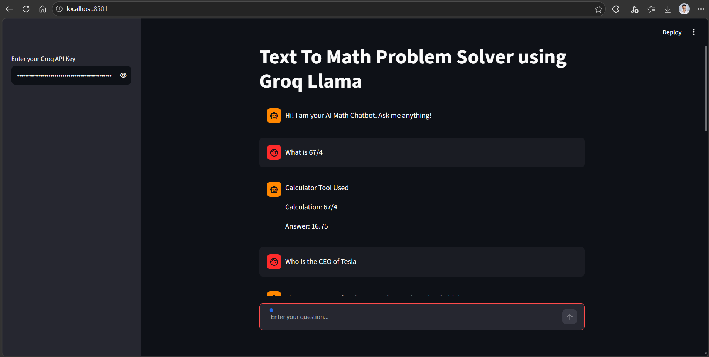
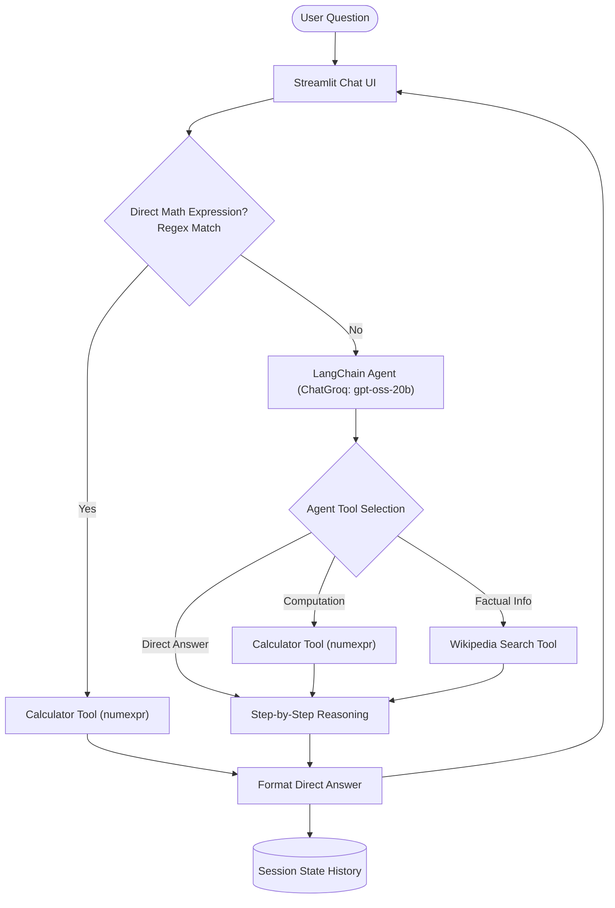

# 🧮 GenAI Assignment 35: Text-to-Math Problem Solver with LangChain Agents & Groq

An interactive conversational AI application built with **Streamlit**, **LangChain Agents**, and **Groq** (`openai/gpt-oss-20b`). This project demonstrates how agentic workflows solve text-to-math problems by combining natural language understanding, factual retrieval via Wikipedia, and deterministic computation via `numexpr`.

---

## 📸 Application Preview



---

## 📌 Task 1: Text-to-Math Agent Overview

### 1. What is a Text-to-Math problem?
A text-to-math problem involves translating mathematical problems described in natural language (such as word problems, arithmetic queries, or formula-driven questions) into formal mathematical expressions or computable numeric solutions.

### 2. Why are agents useful for math reasoning?
Standard LLMs often struggle with pure numerical calculations and multi-step math logic due to tokenization artifacts and hallucination. Agents solve this by:
- Decomposing complex word problems into sequential logical steps.
- Leveraging specialized external tools (e.g., Python math evaluators or calculators) to guarantee 100% calculation accuracy.
- Maintaining natural language reasoning while offloading heavy computation.

### 3. Difference between normal LLM response vs. agent-based reasoning
- **Normal LLM Response**: Operates primarily via next-token prediction based on statistical patterns. It calculates within its internal weights, frequently making arithmetic errors on multi-digit numbers or intricate order of operations.
- **Agent-Based Reasoning**: Uses an iterative loop (Thought $\rightarrow$ Action $\rightarrow$ Observation). It intelligently decides whether and when to call tools (such as `calculator` or `wikipedia_search`), evaluates the output, and synthesizes an accurate, verified step-by-step response.

---

## 🌟 Key Features

- **Hybrid Execution Pipeline**:
  - **Direct Regex Routing**: Automatically catches plain arithmetic expressions (e.g., `25*40`, `100+50/2`) and routes them directly to `numexpr` for instant evaluation.
  - **Agentic Reasoning**: Natural language questions, word problems, and complex queries are routed to the LangChain Agent powered by Groq.
- **Deterministic Calculator Tool**: Powered by `numexpr.evaluate` to execute safe, fast mathematical operations without executing arbitrary code.
- **Factual Grounding Tool**: Integrated with `WikipediaAPIWrapper` to fetch factual context, historical mathematical constants, or definitions when needed.
- **Interactive Streamlit UI**: Chat-style interface with persistent session memory (`st.session_state`), secure API key input in the sidebar, and clear step-by-step breakdowns.

---

## 🏗️ Architecture & Workflow



---

## 📁 Project Structure

```text
GenAI-Assignment35-(Shreyas)/
├── app.png             # Streamlit application screenshot
├── app.py              # Main Streamlit application with LangChain agent & tools
├── .env                # API keys and environment configurations (git-ignored)
├── requirements.txt    # Project dependencies
└── README.md           # Documentation, architectural overview, and theory
```

---

## 📋 Prerequisites

Before running the application, make sure you have:

1. **Python 3.10+** installed.
2. A **Groq API Key** ([console.groq.com](https://console.groq.com/)).

---

## ⚙️ Installation & Setup

### 1. Clone the Repository
```bash
git clone https://github.com/shreyas-650/Assignment-GenAI.git
cd "Assignment-GenAI/GenAI-Assignment35-(Shreyas)"
```

### 2. Create and Activate a Virtual Environment
```bash
# Windows
python -m venv venv
venv\Scripts\activate

# macOS / Linux
python3 -m venv venv
source venv/bin/activate
```

### 3. Install Dependencies
```bash
pip install -r requirements.txt
```

### 4. Configure Environment Variables *(Optional)*
You can create a `.env` file in the root of the assignment directory:
```env
GROQ_API_KEY=your_groq_api_key_here
```
> **Note**: You can also provide your Groq API Key directly in the Streamlit sidebar at runtime.

---

## 🚀 Running the Application

Launch the Streamlit web application with:

```bash
streamlit run app.py
```

1. Enter your **Groq API Key** in the sidebar.
2. Ask direct calculations (e.g., `45 * 12 + 100`) or natural language word problems (e.g., *"If a car travels at 60 km/h for 2.5 hours, how far does it go?"*).
3. The assistant will break down the problem and provide the verified answer step-by-step.

---

## 🛠️ Tools & Models Used

| Component | Technology | Purpose |
|---|---|---|
| **Frontend UI** | `streamlit` | Clean, interactive conversational chat interface |
| **LLM Engine** | `ChatGroq` (`openai/gpt-oss-20b`) | Fast agentic reasoning, tool calling, and prompt synthesis |
| **Agent Framework** | `langchain.agents` (`create_agent`) | Orchestrates thought process and tool execution |
| **Calculator** | `numexpr` | High-performance, safe numeric expression evaluation |
| **Knowledge Base** | `WikipediaAPIWrapper` | Pulls background facts, definitions, and real-world numbers |

---

## 📜 License

This project is part of the GenAI Assignment series by [shreyas-650](https://github.com/shreyas-650).
