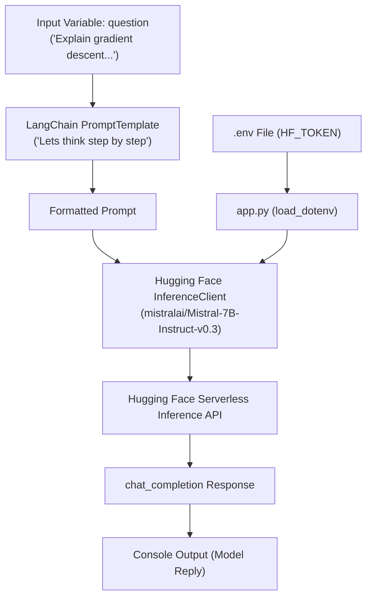

# 🚀 GenAI Assignment 36: Hugging Face Inference API with LangChain Prompt Template

A Python application demonstrating how to integrate **LangChain Prompt Templates** with the **Hugging Face Inference API** (`InferenceClient`) using the open-weight **Mistral-7B-Instruct-v0.3** model. This project illustrates structured prompt engineering using Zero-Shot Chain-of-Thought (CoT) prompting to generate step-by-step explanations for machine learning and technical concepts.

---

## 📌 Project Overview

This assignment focuses on leveraging modern open-source LLMs hosted on Hugging Face infrastructure without requiring local GPU resources. By combining `langchain_core` for reusable prompt orchestration and `huggingface_hub` for cloud inference, the application formats structured inputs and retrieves high-quality completions.

---

## 🌟 Key Features

- **Hugging Face Inference Client**: Connects directly to Hugging Face's serverless Inference API using `huggingface_hub.InferenceClient`.
- **State-of-the-Art Open Model**: Powered by `mistralai/Mistral-7B-Instruct-v0.3`, known for high reasoning ability and instruction following.
- **LangChain Prompt Orchestration**: Uses `PromptTemplate` from `langchain_core.prompts` to decouple prompt logic and variable interpolation from execution code.
- **Chain-of-Thought (CoT) Prompting**: Injects a reasoning trigger (`"Answer: Lets think step by step."`) to stimulate decomposed, logical explanations from the LLM.
- **Secure Configuration**: Uses `python-dotenv` to safely load API tokens from `.env` files without hardcoding secrets.
- **Fine-Tuned Generation Parameters**: Configures `temperature=0.7` for natural variability and `max_tokens=200` to control response length and latency.

---

## 🏗️ Architecture & Workflow



---

## 📁 Project Structure

```text
GenAI-Assignment36-(Shreyas)/
├── app.py              # Main script integrating LangChain prompt & Hugging Face client
├── .env                # Environment variables containing HF_TOKEN (git-ignored)
├── requirements.txt    # Project dependencies
└── README.md           # Documentation, architecture, and usage instructions
```

---

## 📋 Prerequisites

Before running the application, make sure you have:

1. **Python 3.10+** installed.
2. A **Hugging Face User Access Token** with read permissions ([huggingface.co/settings/tokens](https://huggingface.co/settings/tokens)).

---

## ⚙️ Installation & Setup

### 1. Clone the Repository & Navigate to Directory
```bash
git clone https://github.com/shreyas-650/Assignment-GenAI.git
cd "Assignment-GenAI/GenAI-Assignment36-(Shreyas)"
```

### 2. Create and Activate a Virtual Environment
```bash
# Windows
python -m venv venv
venv\Scripts\activate

# macOS / Linux
python3 -m venv venv
source venv/bin/activate
```

### 3. Install Dependencies
```bash
pip install -r requirements.txt
```

### 4. Configure Environment Variables
Create or update your `.env` file in the project root:
```env
HF_TOKEN=your_huggingface_access_token_here
```

---

## 🚀 Running the Application

Execute the Python script:

```bash
python app.py
```

### Expected Output
The script prints the step-by-step response generated by Mistral-7B:

```text
=== Model Reply ===
1. Imagine you are standing on top of a foggy hill and you want to reach the lowest valley.
2. Because you cannot see the entire landscape, you look around your feet and feel which direction slopes downward the steepest.
3. You take a step in that downhill direction.
4. You repeat this process step by step until the ground flattens out—meaning you have reached the bottom.
In machine learning, the hill is the 'error' (loss), and gradient descent is the process of taking steps downward to minimize that error.
```

---

## 🔍 Code Breakdown

### 1. Client Initialization
```python
client = InferenceClient(
    model="mistralai/Mistral-7B-Instruct-v0.3",
    token=HF_TOKEN
)
```
Initializes the Hugging Face inference client targeting Mistral 7B Instruct v0.3 using the token loaded from `.env`.

### 2. Prompt Engineering with LangChain
```python
prompt = PromptTemplate(
    template="""Question: {question}
Answer: Lets think step by step.""",
    input_variables=["question"]
)

formatted_prompt = prompt.format(
    question="Explain gradient descent in simple words."
)
```
Defines a reusable prompt template with input variables and applies Zero-Shot Chain-of-Thought prompting to encourage thorough reasoning.

### 3. Chat Completion Request
```python
response = client.chat_completion(
    model="mistralai/Mistral-7B-Instruct-v0.3",
    messages=[
        {
            "role": "user",
            "content": formatted_prompt
        }
    ],
    max_tokens=200,
    temperature=0.7
)
```
Dispatches an OpenAI-compatible chat completion payload to Hugging Face with bounded token length (`max_tokens=200`) and balanced sampling temperature (`temperature=0.7`).

---

## 🛠️ Tools & Technologies Used

| Component | Technology | Purpose |
|---|---|---|
| **Language** | Python 3.10+ | Core programming runtime |
| **Model Hosting** | Hugging Face Hub | Cloud inference API without local GPU requirements |
| **LLM** | `Mistral-7B-Instruct-v0.3` | High-performance open-source instruction-tuned model |
| **Prompt Framework** | `langchain-core` (`PromptTemplate`) | Declarative prompt template construction & parameterization |
| **SDK** | `huggingface_hub` (`InferenceClient`) | Official Python client for Hugging Face inference |
| **Config Management** | `python-dotenv` | Secure API token loading from `.env` files |

---

## 📜 License

This project is part of the GenAI Assignment series by [shreyas-650](https://github.com/shreyas-650).
