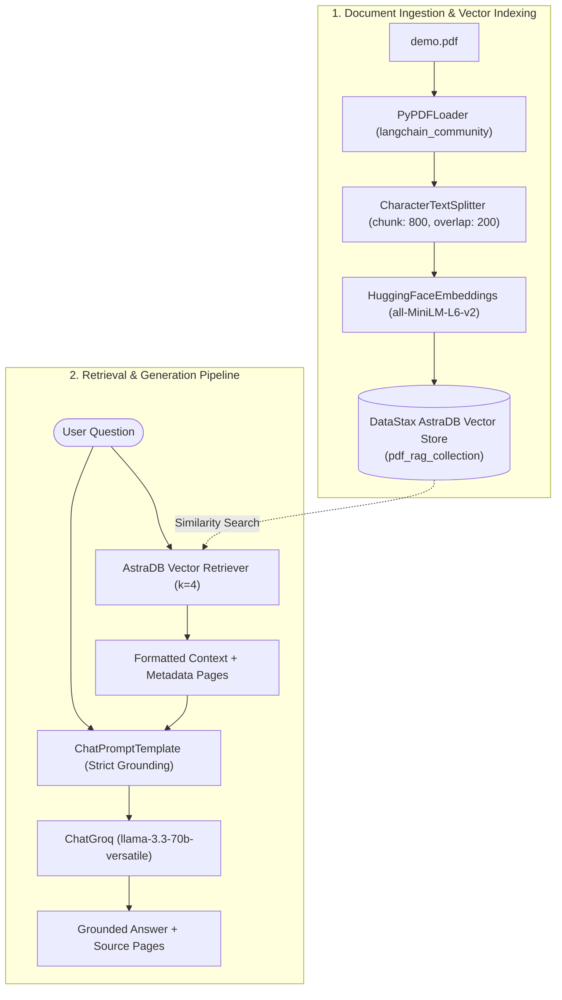

# 📚 GenAI Assignment 37: End-to-End PDF RAG Pipeline with DataStax AstraDB & Groq

A robust, terminal-based **Retrieval-Augmented Generation (RAG)** pipeline built using **LangChain**, **DataStax AstraDB Vector Store**, **Hugging Face Sentence Transformers**, and **Groq** (`llama-3.3-70b-versatile`). This application ingests PDF documents, splits content into overlapping semantic chunks, embeds them into a cloud-native vector database, and executes context-grounded question answering with source page attribution.

---

## 📌 Project Overview

Traditional LLMs suffer from knowledge cutoffs and lack domain-specific document awareness. This project addresses those limitations by constructing an end-to-end RAG architecture:
1. **Document Ingestion**: Parsing PDF documents (`demo.pdf`) via `PyPDFLoader`.
2. **Text Chunking**: Splitting text using `CharacterTextSplitter` with configurable chunk size and overlap to preserve cross-boundary context.
3. **Dense Vector Embeddings**: Generating embeddings using `sentence-transformers/all-MiniLM-L6-v2` via `HuggingFaceEmbeddings`.
4. **Cloud Vector Storage**: Storing and indexing document embeddings in **DataStax AstraDB** (`AstraDBVectorStore`).
5. **Contextual Retrieval & Generation**: Retrieving top-$k$ relevant chunks and synthesizing precise, hallucination-free answers using **Groq** (`llama-3.3-70b-versatile`) while citing source pages.

---

## 🌟 Key Features

- **Document Parsing with Metadata**: Extracts text along with page numbers from PDF files using `PyPDFLoader`.
- **Sliding-Window Text Splitting**: Chunks text with `chunk_size=800` and `chunk_overlap=200` to prevent loss of semantic context.
- **High-Quality Local Embeddings**: Uses `sentence-transformers/all-MiniLM-L6-v2` (384-dimensional embeddings) to eliminate embedding API costs.
- **Serverless Cloud Vector Database**: Integrates directly with **DataStax AstraDB Vector** (`AstraDBVectorStore`), providing scalable serverless similarity search.
- **Ultra-Fast LLM Inference**: Powered by **Groq** with `llama-3.3-70b-versatile` operating at zero temperature for deterministic, factual outputs.
- **Strict Grounding Prompt**: Enforces strict instructions preventing the model from hallucinating outside the provided PDF context.
- **Interactive Terminal Session & Source Attribution**: Continuous Q&A loop with source page tracking for verifiable answers.

---

## 🏗️ Architecture & Workflow



---

## 📁 Project Structure

```text
GenAI-Assignment37-(Shreyas)/
├── app.py              # Main RAG pipeline (ingestion, vector storage, query loop)
├── demo.pdf            # Input PDF document for question answering (user-provided)
├── .env                # Environment credentials for AstraDB and Groq (git-ignored)
├── requirements.txt    # Project dependencies
└── README.md           # Documentation, architectural guide, and usage instructions
```

---

## 📋 Prerequisites

Before running the application, make sure you have:

1. **Python 3.10+** installed.
2. A **Groq API Key** ([console.groq.com](https://console.groq.com/)).
3. A **DataStax AstraDB Account** with a Vector Database created ([astra.datastax.com](https://astra.datastax.com/)):
   - **Application Token** (`AstraCS:...`)
   - **API Endpoint URL** (`https://<db-id>-<region>.apps.astra.datastax.com`)
4. A sample PDF document named `demo.pdf` placed in the project root.

---

## ⚙️ Installation & Setup

### 1. Clone the Repository & Navigate to Directory
```bash
git clone https://github.com/shreyas-650/Assignment-GenAI.git
cd "Assignment-GenAI/GenAI-Assignment37-(Shreyas)"
```

### 2. Create and Activate a Virtual Environment
```bash
# Windows
python -m venv venv
venv\Scripts\activate

# macOS / Linux
python3 -m venv venv
source venv/bin/activate
```

### 3. Install Dependencies
```bash
pip install -r requirements.txt
```

### 4. Configure Environment Variables
Create a `.env` file in the project root with your credentials:
```env
GROQ_API_KEY=gsk_your_groq_api_key_here
ASTRA_DB_APPLICATION_TOKEN=AstraCS:your_astradb_token_here
ASTRA_DB_API_ENDPOINT=https://your-db-id-region.apps.astra.datastax.com
```

### 5. Add Your PDF File
Place the PDF you want to query inside the project directory and name it `demo.pdf` (or update `pdf_path` in `app.py`).

---

## 🚀 Running the Application

Execute the script:

```bash
python app.py
```

### Sample Terminal Execution

```text
PDF Loaded Successfully!
Total Chunks: 18
Documents stored in AstraDB successfully!

Enter your Question (Or type quit to exit): What are the primary objectives outlined in the document?

Answer:
The primary objectives outlined in the document are:
1. Establishing automated data ingestion pipelines.
2. Improving cross-departmental coordination through unified reporting.
3. Reducing latency in predictive analytics queries.

Source Pages:
1
2
------------------------------------------------------------
What's your Next Question or type quit to Exit: quit
Thank you for using PDF RAG!
```

---

## 🔍 Code Breakdown

### 1. Document Loading & Text Splitting
```python
loader = PyPDFLoader("demo.pdf")
documents = loader.load()

text_splitter = CharacterTextSplitter(
    separator="\n",
    chunk_size=800,
    chunk_overlap=200,
    length_function=len
)
texts = text_splitter.split_documents(documents)
```
Loads the PDF and segments it into 800-character overlapping chunks to maintain semantic coherence across split boundaries.

### 2. Embeddings & AstraDB Vector Store
```python
embedding_model = HuggingFaceEmbeddings(
    model_name="sentence-transformers/all-MiniLM-L6-v2"
)

astra_vector_store = AstraDBVectorStore(
    embedding=embedding_model,
    collection_name="pdf_rag_collection",
    token=os.getenv("ASTRA_DB_APPLICATION_TOKEN"),
    api_endpoint=os.getenv("ASTRA_DB_API_ENDPOINT")
)
astra_vector_store.add_documents(texts)
```
Generates 384-dimensional dense vectors and uploads chunks directly into the AstraDB cloud collection `pdf_rag_collection`.

### 3. Strict Grounding Prompt & Generation
```python
prompt = ChatPromptTemplate.from_template("""
You are a helpful PDF question-answering assistant.

Answer the question using ONLY the provided context.
If the answer is not available in the context,
clearly say that the information is not present in the PDF.

Context:
{context}

Question:
{question}

Answer:
""")
```
Prevents hallucination by constraining the model to answer exclusively from the retrieved context.

---

## 🛠️ Tools & Technologies Used

| Component | Technology | Purpose |
|---|---|---|
| **PDF Loader** | `pypdf` / `langchain_community` | Extracts raw text and page-level metadata from PDF files |
| **Chunking Engine** | `langchain_text_splitters` | Implements sliding-window chunking with overlap |
| **Embedding Model** | `sentence-transformers/all-MiniLM-L6-v2` | Computes dense vector representations of text |
| **Vector Database** | DataStax AstraDB (`langchain_astradb`) | Cloud serverless vector search and document indexing |
| **LLM Engine** | `ChatGroq` (`llama-3.3-70b-versatile`) | Fast, low-latency reasoning and grounded synthesis |
| **Prompt Orchestration** | `langchain_core` | Formats dynamic prompt templates and chains |
| **Configuration** | `python-dotenv` | Securely manages API keys and database credentials |

---

## 📜 License

This project is part of the GenAI Assignment series by [shreyas-650](https://github.com/shreyas-650).
