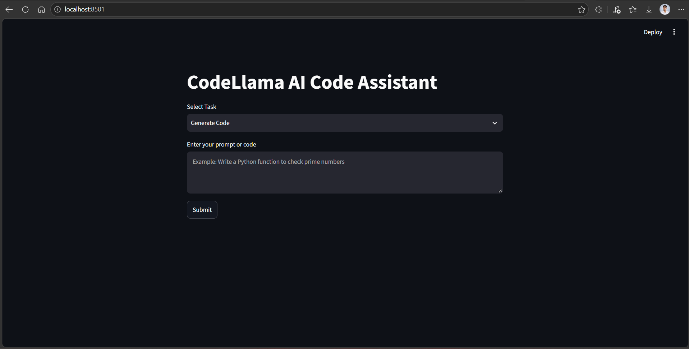
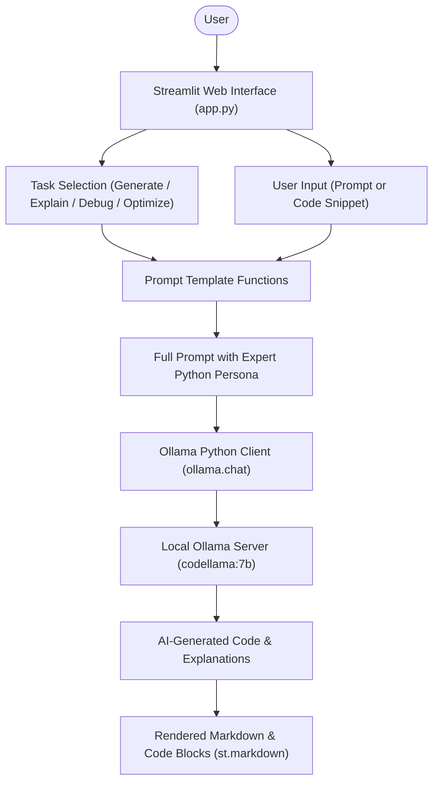

# 💻 GenAI Assignment 38: CodeLlama AI Code Assistant with Ollama & Streamlit

An interactive AI-powered coding companion built using **Streamlit** and **Ollama**, powered by Meta's open-weight **CodeLlama** (`codellama:7b`). The assistant runs completely locally, providing fast, private, and offline assistance for generating Python code, explaining complex logic, debugging errors, and optimizing code performance.

---

## 📸 Application Preview



---

## 📌 Project Overview

This assignment focuses on utilizing locally hosted open-source Large Language Models specialized in programming tasks. By pairing **Ollama** with a lightweight **Streamlit** web interface, this tool provides developers with an intelligent copilot that requires no external API keys or cloud subscriptions, ensuring total code privacy and zero inference costs.

---

## 🌟 Key Features

- **100% Local & Private Execution**: Runs offline via Ollama without sending code or prompts to external cloud servers.
- **Specialized Code Model**: Driven by `codellama:7b`, fine-tuned specifically for code synthesis, comprehension, and debugging.
- **Four Core Developer Modes**:
  - **Generate Code**: Crafts clean, PEP 8-compliant Python functions and scripts from natural language descriptions.
  - **Explain Code**: Deconstructs code snippets, logic flow, and algorithms into plain, easy-to-understand explanations.
  - **Debug Code**: Detects syntax errors, edge cases, and runtime bugs, explaining what went wrong and supplying the fixed code.
  - **Optimize Code**: Refactors code for enhanced time/space complexity, performance, and readability.
- **Structured System Prompting**: Wraps user prompts with an expert persona to ensure well-formatted, typed, and documented Python code.
- **Interactive Streamlit Web UI**: Simple task selection dropdown, flexible multiline input editor, loading indicators, and Markdown-rendered code blocks with syntax highlighting.

---

## 🏗️ Architecture & Workflow



---

## 📁 Project Structure

```text
GenAI-Assignment38-(Shreyas)/
├── app.png             # Application preview screenshot
├── app.py              # Main Streamlit application with Ollama integration
├── requirements.txt    # Project dependencies
└── README.md           # Documentation, setup guide, and usage instructions
```

---

## 📋 Prerequisites

Before running the application, make sure you have:

1. **Python 3.10+** installed.
2. **Ollama** installed on your system ([Download Ollama](https://ollama.com/download)).
3. The **CodeLlama 7B** model pulled locally:
   ```bash
   ollama pull codellama:7b
   ```

---

## ⚙️ Installation & Setup

### 1. Clone the Repository & Navigate to Directory
```bash
git clone https://github.com/shreyas-650/Assignment-GenAI.git
cd "Assignment-GenAI/GenAI-Assignment38-(Shreyas)"
```

### 2. Create and Activate a Virtual Environment
```bash
# Windows
python -m venv venv
venv\Scripts\activate

# macOS / Linux
python3 -m venv venv
source venv/bin/activate
```

### 3. Install Dependencies
```bash
pip install -r requirements.txt
```

### 4. Verify Ollama Server is Running
Ensure the Ollama background service is active and the model is downloaded:
```bash
ollama list
```
You should see `codellama:7b` listed under your available models.

---

## 🚀 Running the Application

Launch the Streamlit web application:

```bash
streamlit run app.py
```

1. Open your browser at `http://localhost:8501`.
2. Choose a task from the **Select Task** dropdown (`Generate Code`, `Explain Code`, `Debug Code`, or `Optimize Code`).
3. Enter your natural language prompt or paste your code snippet into the text area.
4. Click **Submit** to receive a structured response from CodeLlama.

---

## 🔍 Code Breakdown

### 1. Task Prompt Helper Functions
```python
def generate_code(text):
    return f"Generate clean Python code for: {text}"

def explain_code(text):
    return f"Explain this code step by step:\n{text}"

def debug_code(text):
    return f"Find bugs and provide corrected code:\n{text}"

def optimize_code(text):
    return f"Optimize this code and explain improvements:\n{text}"
```
Modular helper functions map specific engineering tasks to tailored prompt directives.

### 2. Expert Persona & Prompt Construction
```python
prompt = f"""
You are an expert Python coding assistant.

{prompts[task](user_input)}

Provide a clear, structured and readable response.
Use properly formatted Python code where needed.
"""
```
Structures the prompt with persona framing and readability guidelines to ensure high-quality, production-ready output.

### 3. Local Model Invocation with Ollama
```python
with st.spinner("CodeLlama is thinking..."):
    response = ollama.chat(
        model="codellama:7b",
        messages=[
            {"role": "user", "content": prompt}
        ]
    )
```
Streams the request to the local Ollama inference server and displays the formatted Markdown response.

---

## 🛠️ Tools & Technologies Used

| Component | Technology | Purpose |
|---|---|---|
| **Frontend UI** | Streamlit | Responsive web UI with task selection and Markdown output |
| **Local LLM Engine** | Ollama | High-efficiency local inference server for open-weight models |
| **Foundation Model** | `codellama:7b` (Meta) | Pretrained and instruction-tuned model for coding tasks |
| **Python Client** | `ollama-python` | Official Python API wrapper for Ollama |
| **Language** | Python 3.10+ | Core application runtime |

---

## 📜 License

This project is part of the GenAI Assignment series by [shreyas-650](https://github.com/shreyas-650).
