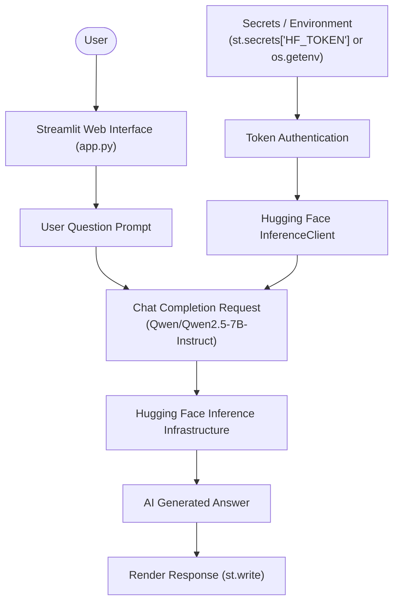

# 🌐 GenAI Assignment 39: GenAI Assistant with Hugging Face & Cloud Deployment Comparison

An interactive GenAI question-answering web application built with **Streamlit** and the **Hugging Face Inference API**, powered by the state-of-the-art **Qwen 2.5 7B Instruct** (`Qwen/Qwen2.5-7B-Instruct`) model. This assignment demonstrates building cloud-ready LLM interfaces and provides an in-depth comparison between deployment platforms: **Streamlit Community Cloud** and **Hugging Face Spaces**.

---

## 📌 Project Overview

This project showcases how to build and configure a production-ready Generative AI assistant designed for seamless cloud deployment. The application uses dual-source secret handling (`st.secrets` for cloud deployments and environment variables `os.getenv` for local development) to communicate with Hugging Face's serverless Inference API.

---

## 🌟 Key Features

- **High-Performance Open LLM**: Leverages `Qwen/Qwen2.5-7B-Instruct`, recognized for strong reasoning, coding, and multilingual performance.
- **Hugging Face Inference API**: Serverless inference via `huggingface_hub.InferenceClient` using modern API token authentication.
- **Dual-Source Secret Management**: Transparently reads API tokens from `st.secrets` (Streamlit Cloud / HF Spaces) or `.env` / system environment variables (`os.getenv("HF_TOKEN")`), preventing accidental token leaks.
- **Interactive Streamlit Web UI**: Clean input area, loading spinners (`st.spinner`), error/warning guards, and structured response rendering.
- **Cloud-Ready Architecture**: Structured and optimized for one-click deployment on Streamlit Community Cloud and Hugging Face Spaces.
- **Platform Deployment Analysis**: Comprehensive evaluation comparing Streamlit Community Cloud vs. Hugging Face Spaces for AI applications.

---

## 🏗️ Architecture & Workflow



---

## 📁 Project Structure

```text
GenAI-Assignment39-(Shreyas)/
├── app.py              # Main Streamlit application with Hugging Face client
├── requirements.txt    # Application dependencies (streamlit, huggingface_hub)
└── README.md           # Documentation, deployment guide, and platform comparison
```

---

## 📋 Prerequisites

Before running or deploying the application, make sure you have:

1. **Python 3.10+** installed.
2. A **Hugging Face User Access Token** with read permissions ([huggingface.co/settings/tokens](https://huggingface.co/settings/tokens)).

---

## ⚙️ Local Installation & Setup

### 1. Clone the Repository & Navigate to Directory
```bash
git clone https://github.com/shreyas-650/Assignment-GenAI.git
cd "Assignment-GenAI/GenAI-Assignment39-(Shreyas)"
```

### 2. Create and Activate a Virtual Environment
```bash
# Windows
python -m venv venv
venv\Scripts\activate

# macOS / Linux
python3 -m venv venv
source venv/bin/activate
```

### 3. Install Dependencies
```bash
pip install -r requirements.txt
```

### 4. Configure Secrets / Environment
For local development, set your `HF_TOKEN` environment variable or create `.streamlit/secrets.toml`:

**Option A — `.streamlit/secrets.toml`:**
```toml
HF_TOKEN = "your_huggingface_access_token_here"
```

**Option B — Environment Variable (PowerShell):**
```powershell
$env:HF_TOKEN = "your_huggingface_access_token_here"
```

---

## 🚀 Running Locally

Launch the Streamlit web application:

```bash
streamlit run app.py
```

Open your browser at `http://localhost:8501`, enter any question or technical prompt, and click **Generate Answer**.

---

## ☁️ Deployment Guide

### Deploying to Streamlit Community Cloud
1. Push this project folder to your GitHub repository.
2. Go to [share.streamlit.io](https://share.streamlit.io/) and create a **New app**.
3. Select your repository, branch, and specify the main file path:
   ```text
   GenAI-Assignment39-(Shreyas)/app.py
   ```
4. Click **Advanced Settings** and add your secret under **Secrets**:
   ```toml
   HF_TOKEN = "your_huggingface_token"
   ```
5. Click **Deploy!**.

### Deploying to Hugging Face Spaces
1. Create a new Space at [huggingface.co/spaces](https://huggingface.co/spaces).
2. Select **Streamlit** as the Space SDK.
3. Push `app.py` and `requirements.txt` to the Space repository.
4. Go to **Settings** > **Variables and secrets** > **New secret**:
   - Key: `HF_TOKEN`
   - Value: `your_huggingface_token`
5. The Space will automatically build and launch your application.

---

## 📊 Task 3: Platform Comparison — Streamlit Cloud vs. Hugging Face Spaces

| Feature / Aspect | Streamlit Community Cloud | Hugging Face Spaces |
|---|---|---|
| **Primary Use Case** | Python data dashboards, rapid prototypes, and general web applications | AI/ML demonstrations, LLM interfaces, and model showcase hubs |
| **Supported SDKs** | Streamlit (Python) | Streamlit, Gradio, Docker, Static HTML |
| **Hardware Options** | Shared standard CPU instances | Free CPU tiers + optional paid GPU hardware (T4, A10G, A100) |
| **GitHub Integration** | Native automatic deployment on git push | Native Git/GitHub sync or direct Space Git repository |
| **Secret Management** | Built-in encrypted `secrets.toml` manager | Built-in encrypted repository Secrets & Variables |
| **Pros** | • Effortless zero-configuration setup<br>• Fast GitHub CI/CD pipeline<br>• Clean, modern dashboard layout | • Tailored for AI/ML ecosystem<br>• Native access to Hugging Face Hub models & datasets<br>• Docker flexibility for custom dependencies |
| **Cons** | • Strictly CPU-only; resource bounds on heavy compute<br>• Limited to Streamlit framework | • Docker configurations can be complex for beginners<br>• Free tier sleeps after inactivity |
| **When to Choose** | When building interactive dashboards, data analysis tools, or standard Python web applications. | When deploying GenAI/LLM demos, ML portfolio projects, or apps requiring GPU acceleration. |

---

## 🛠️ Tools & Technologies Used

| Component | Technology | Purpose |
|---|---|---|
| **Frontend UI** | Streamlit | Clean, interactive web interface with responsive state handling |
| **Cloud Inference** | Hugging Face Hub | Cloud serverless inference without local GPU dependencies |
| **LLM Model** | `Qwen/Qwen2.5-7B-Instruct` | Instruction-tuned language model with strong reasoning |
| **API Client** | `huggingface_hub` (`InferenceClient`) | Official SDK to interface with Hugging Face models |
| **Configuration** | `st.secrets` & `os.getenv` | Dual-source secure credentials handling |

---

## 📜 License

This project is part of the GenAI Assignment series by [shreyas-650](https://github.com/shreyas-650).
